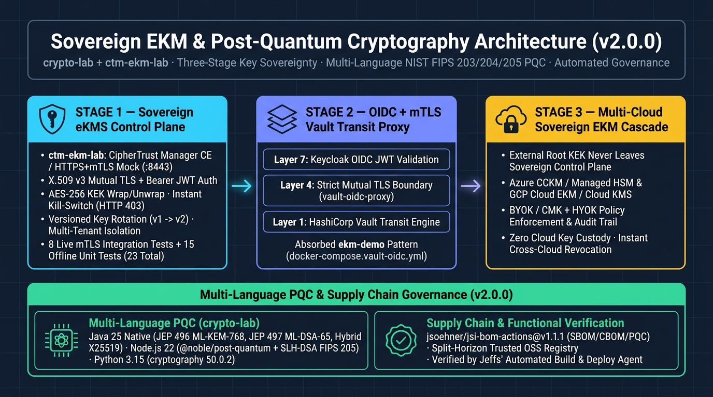

# Crypto Lab

*(Formerly `secure_crypto_reference_examples`)*

Vetted classical and post-quantum (PQC) cryptographic reference implementations in **Python**, **Java 25**, **JavaScript (Node.js 22)**, and **PowerShell**, paired with Architectural Decision Records (ADRs) and an automated SBOM/CBOM supply-chain pipeline.

**Version:** `1.6.0` (see [CHANGELOG.md](CHANGELOG.md) and [PQC Migration Assessment](docs/security/PQC_MIGRATION_ASSESSMENT.md))

## Why This Project Exists

Teams migrating to modern cryptography face two recurring problems:
1. **Misconfigured classical primitives** (reused nonces, missing AAD, non-constant-time tag checks, or weak KDFs).
2. **Quantum migration blind spots** ("Harvest Now, Decrypt Later" exposure on RSA, X25519, and Ed25519 without visibility into where those primitives live).

This repository serves as a hands-on reference exercise. It shows how to implement each primitive safely, test both happy paths and tamper rejection, and audit the resulting codebase with automated Software and Cryptographic Bills of Materials (SBOM & CBOM).

## PQC Upgrade Path Dashboard

This dashboard summarizes current PQC support across the repository's language runtimes and highlights where native upgrades are blocked. See the full [PQC Upgrade Path Support & Blockers Report](docs/security/PQC_UPGRADE_PATH_SUPPORT.md) and [PQC Migration Assessment](docs/security/PQC_MIGRATION_ASSESSMENT.md).

| Language / Runtime | Classical Asymmetric | ML-KEM-768 (FIPS 203) | Hybrid X25519 + ML-KEM-768 | ML-DSA-65 (FIPS 204) | SLH-DSA (FIPS 205) | Current Blocker / Next Unlock |
|---|---|---|---|---|---|---|
| **Java 25** (`OpenJDK 25.0.4.1`) | `X25519`, `Ed25519`, `RSA-3072` | 🟢 Native (JEP 496) | 🟢 Native | 🟢 Native (JEP 497) | 🔴 Blocked | Standard JCA lacks `SLH-DSA`; LTS `< JDK 24` lacks all PQC |
| **JavaScript** (`Node.js v22.23.2`) | `X25519` (`node:crypto`) | 🟡 `@noble/post-quantum` | 🟡 `node:crypto` + `@noble` | 🟡 `@noble/post-quantum` | 🟡 `@noble/post-quantum` | `node:crypto` stdlib awaits OpenSSL 3.5+ PQC bindings |
| **Python** (`cryptography 50.0.0`) | `X25519`, `Ed25519`, `RSA-3072` | 🔴 Blocked | 🔴 Blocked | 🔴 Blocked | 🔴 Blocked | PyCA `cryptography` has no native `ML-KEM`/`ML-DSA`/`SLH-DSA` API yet |
| **PowerShell** (`.NET`) | `AesGcm` only | 🔴 Blocked | 🔴 Blocked | 🔴 Blocked | 🔴 Blocked | Requires .NET 10+ and OS OpenSSL 3.5+ / CNG support |

## Supported Primitives & PQC Readiness

| Category | Primitive / Standard | Quantum Status | Python | Java 25 | JavaScript (Node.js) | PowerShell |
|---|---|---|---|---|---|---|
| **PQC Key Encapsulation** | **ML-KEM-768** (NIST FIPS 203) & KEM-DEM | Post-Quantum Ready | — | [MlKemExample.java](java/src/main/java/org/example/crypto/MlKemExample.java) | [ml_kem_example.js](javascript/src/ml_kem_example.js) | — |
| **Hybrid Key Agreement** | **X25519 + ML-KEM-768** + HKDF-SHA-256 | Post-Quantum Ready (Hybrid) | — | [HybridX25519MlKemExample.java](java/src/main/java/org/example/crypto/HybridX25519MlKemExample.java) | [hybrid_kem_example.js](javascript/src/hybrid_kem_example.js) | — |
| **PQC Digital Signatures** | **ML-DSA-65** (NIST FIPS 204) | Post-Quantum Ready | — | [MlDsaExample.java](java/src/main/java/org/example/crypto/MlDsaExample.java) | [ml_dsa_example.js](javascript/src/ml_dsa_example.js) | — |
| **PQC Hash-Based Signatures** | **SLH-DSA-SHA2-128f** (NIST FIPS 205) | Post-Quantum Ready | — | — | [slh_dsa_example.js](javascript/src/slh_dsa_example.js) | — |
| **Authenticated Encryption** | **AES-256-GCM** (96-bit CSPRNG nonce + AAD) | Grover-Resistant (256-bit) | [aes_gcm_example.py](python/aes_gcm_example.py) | [AesGcmExample.java](java/src/main/java/org/example/crypto/AesGcmExample.java) | [aes_gcm_example.js](javascript/src/aes_gcm_example.js) | [AesGcmExample.ps1](powershell/AesGcmExample.ps1) |
| **Hashing & MAC** | **SHA-256**, **HMAC-SHA-256** | Grover-Resistant | [hashing_example.py](python/hashing_example.py), [hmac_example.py](python/hmac_example.py) | [HashingExample.java](java/src/main/java/org/example/crypto/HashingExample.java), [HmacExample.java](java/src/main/java/org/example/crypto/HmacExample.java) | [hashing.js](javascript/src/hashing.js), [hmac_example.js](javascript/src/hmac_example.js) | — |
| **Password KDF** | **PBKDF2-HMAC-SHA-256** | Grover-Resistant | [pbkdf2_example.py](python/pbkdf2_example.py) | [Pbkdf2Example.java](java/src/main/java/org/example/crypto/Pbkdf2Example.java) | — | — |
| **Key Wrapping & Storage** | **AES Key Wrap (RFC 3394)**, Encrypted PKCS#8 PEM | Grover-Resistant | [aes_key_wrap_example.py](python/aes_key_wrap_example.py), [private_key_serialisation_example.py](python/private_key_serialisation_example.py) | [AesKeyWrapExample.java](java/src/main/java/org/example/crypto/AesKeyWrapExample.java) | — | — |
| **Cloud HSM (BYOK & CMK)** | Azure Managed HSM & GCP Cloud KMS (`RSA-OAEP` + `AES-KWP` + Envelope) | Cloud-Managed | [azure_keyvault_byok_cmk_example.py](python/azure_keyvault_byok_cmk_example.py), [gcp_kms_byok_cmk_example.py](python/gcp_kms_byok_cmk_example.py) | — | — | — |
| **External KMS (EKM / HYOK)** | Sovereign Remote Wrap/Unwrap, Policy & Kill-Switch; CipherTrust CE, Vault OIDC Proxy & Stage 3 Multi-Cloud Cascade | Sovereign Control | [external_kms_ekm_example.py](python/external_kms_ekm_example.py), [ciphertrust_ekm_example.py](python/ciphertrust_ekm_example.py), [vault_ekm_proxy_example.py](python/vault_ekm_proxy_example.py), [stage3_multi_cloud_ekm_orchestration.py](python/stage3_multi_cloud_ekm_orchestration.py) | — | — | — |
| **Classical Asymmetric** | **X25519+HKDF**, **Ed25519**, **RSA-3072 OAEP/PSS** | Quantum-Vulnerable (Migration Target) | [x25519_hkdf_example.py](python/x25519_hkdf_example.py), [ed25519_example.py](python/ed25519_example.py), [rsa_oaep_pss_example.py](python/rsa_oaep_pss_example.py) | [X25519HkdfExample.java](java/src/main/java/org/example/crypto/X25519HkdfExample.java), [Ed25519Example.java](java/src/main/java/org/example/crypto/Ed25519Example.java), [RsaOaepPssExample.java](java/src/main/java/org/example/crypto/RsaOaepPssExample.java) | — | — |

## Quickstart

### Prerequisites
- **Python 3.10+**: `pip install -r python/requirements.txt`
- **Java 25+** (OpenJDK 24+ required for built-in `ML-KEM` and `ML-DSA` JCA providers)
- **Node.js 22+**: `cd javascript && npm install`
- **PowerShell 7+** (`pwsh`, optional for `powershell/AesGcmExample.ps1`)

### Run Interactive Demos

```bash
# Bash (prompts for python, java, javascript, powershell, both, or all — or pass as an argument)
./demo_langs.sh all
```

```powershell
# PowerShell
.\demo_langs.ps1 -Choice all
```

### Run Test Suites

```bash
# Python unit tests (positive + tamper/wrong-AAD/wrong-password checks)
python3 -m unittest discover -s python -p 'test_*.py' -v

# Java examples + assertions (CryptoSupport.require + -ea)
./java/run_all.sh
java -ea -cp java/out org.example.crypto.TestCrypto

# JavaScript unit tests (AES-GCM, SHA-256, HMAC, ML-KEM-768, ML-DSA-65)
npm --prefix javascript test
```

## Live External KMS Integration (`ctm-ekm-lab` Dependency)



When the companion [ctm-ekm-lab](https://github.com/jsoehner/ctm-ekm-lab) service (or a real CipherTrust Manager Community Edition appliance) is running and `.env.ciphertrust` is sourced, `crypto-lab` automatically switches from offline simulation to live HTTPS + mTLS mode:

```bash
set -a && source /path/to/ctm-ekm-lab/.env.ciphertrust && set +a

# ./demo_langs.sh detects CIPHERTRUST_URL and runs the live EKM client
./demo_langs.sh python

# Run all unit tests plus the 8 live CTM integration tests
python3 -m unittest discover -s python -p 'test_*.py' -v
```

### Verified Capabilities When `ctm-ekm-lab` Is Running
1. **mTLS + JWT Key Provisioning**: Authenticates over mutual TLS and creates/inspects AES-256 KEKs (`/api/v1/vault/keys2`).
2. **Live Envelope Encryption**: Wraps and unwraps local AES-256-GCM DEKs via CipherTrust (`/api/v1/crypto/{encrypt,decrypt}`).
3. **AAD & Tamper Rejection**: Rejects mismatched AAD at KEK unwrap (`HTTP 400`) and tampered ciphertext locally (`InvalidTag`).
4. **Cryptographic Kill-Switch & Recovery**: `deactivate_key()` blocks decryption (`HTTP 403`); `reactivate_key()` restores access.
5. **Versioned Key Rotation**: `rotate_key()` advances the KEK to `v2` for new wraps while `v1` envelopes continue to unwrap.
6. **Multi-Tenant Isolation**: Deactivating one tenant's KEK leaves other tenants' KEKs operational.
7. **Auth & mTLS Enforcement**: Rejects invalid credentials/JWTs (`HTTP 401`) and unauthenticated TLS clients (`SSLError`).

## How to Adopt These Patterns

1. **Start from the ADR**: Read the decision record in [ADRs/](ADRs/) for the primitive you need before copying code. Each ADR explains key sizes, nonces, padding, and tradeoffs.
2. **Use 256-bit symmetric keys and SHA-256+**: AES-256-GCM and SHA-256 retain 128-bit security against Grover's algorithm. Generate a fresh 96-bit CSPRNG nonce per encryption and bind context via Additional Authenticated Data (AAD).
3. **Plan PQC migration with FIPS 203 & 204**:
   - Replace or hybridize `X25519` / `RSA-OAEP` key exchange with **ML-KEM-768** + **HKDF-SHA-256** ([MlKemExample.java](java/src/main/java/org/example/crypto/MlKemExample.java), [ml_kem_example.js](javascript/src/ml_kem_example.js)).
   - Replace `Ed25519` / `RSA-PSS` signatures with **ML-DSA-65** ([MlDsaExample.java](java/src/main/java/org/example/crypto/MlDsaExample.java), [ml_dsa_example.js](javascript/src/ml_dsa_example.js)).
4. **Verify failure modes**: Every wrapper should reject tampered ciphertexts, mismatched AAD, and invalid signatures in constant time.

## Automated SBOM, CBOM & PQC Audit Pipeline

This repository tracks component and cryptographic inventory in CI ([.github/workflows/sbom-cbom.yml](.github/workflows/sbom-cbom.yml)) and publishes the latest assessment to [docs/security/CRYPTOGRAPHIC_AUDIT.md](docs/security/CRYPTOGRAPHIC_AUDIT.md).

### Run the Audit Locally

```bash
# Generate SBOM, CBOM, and AST cryptographic scan results into oss/
bash scripts/generate_boms.sh -t dir -o oss .

# Validate generated BOM schemas and coverage
bash scripts/test_boms.sh oss

# Generate the PQC readiness markdown summary
python3 scripts/analyze_cbom.py oss/cbom.json --sbom oss/sbom.cyclonedx.json --markdown oss/crypto-summary.md
```

### Architectural Decision Records

- [ADR-001: Cryptographic Standards](ADRs/001-cryptographic-standards.md)
- [ADR-002: Authenticated Encryption (AES-GCM)](ADRs/002-authenticated-encryption-aes-gcm.md)
- [ADR-003: Password Hashing (PBKDF2)](ADRs/003-password-hashing-pbkdf2.md)
- [ADR-004: Key Agreement (X25519 + HKDF)](ADRs/004-key-agreement-x25519-hkdf.md)
- [ADR-005: Asymmetric Cryptography (RSA-OAEP / PSS)](ADRs/005-asymmetric-cryptography-rsa-oaep-pss.md)
- [ADR-006: Digital Signatures (Ed25519)](ADRs/006-digital-signatures-ed25519.md)
- [ADR-007: Message Authentication (HMAC)](ADRs/007-message-authentication-hmac.md)
- [ADR-008: Key Wrapping & Serialization](ADRs/008-key-wrapping-and-serialization.md)
- [ADR-009: Automated SBOM & CBOM Governance](ADRs/009-automated-sbom-cbom-supply-chain-governance.md)
- [ADR-010: Post-Quantum Cryptography (ML-KEM-768 & ML-DSA-65)](ADRs/010-post-quantum-cryptography-ml-kem-ml-dsa.md)
- [ADR-011: Cloud HSM BYOK/CMK & External KMS (EKM/HYOK) Control](ADRs/011-cloud-hsm-byok-cmk-and-ekm-control.md)
- [ADR-012: Sovereign eKMS Integration & Educational Observability](ADRs/012-sovereign-ekm-integration-and-educational-observability.md)
- [ADR-013: Absorption of OIDC + mTLS Vault Transit EKM Proxy (`ekm-demo`)](ADRs/013-oidc-mtls-ekm-proxy-and-vault-transit-absorption.md)

## Contributing

See [CONTRIBUTING.md](CONTRIBUTING.md) for setup instructions, security rules, and PR requirements.
