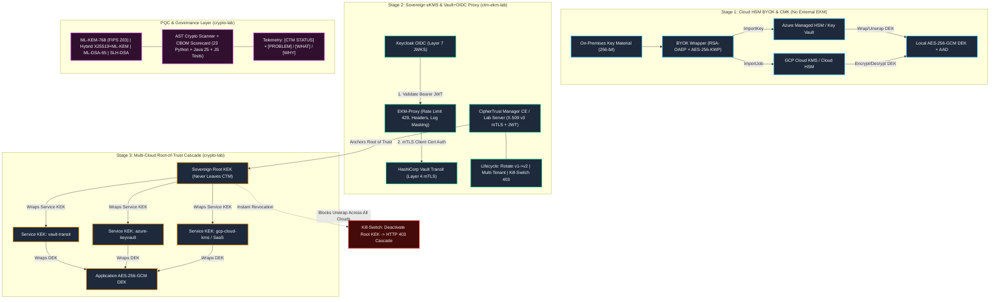
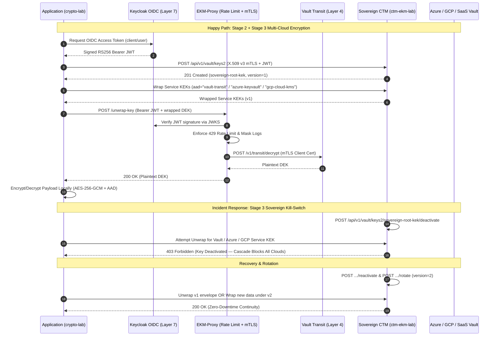

# Three-Stage Sovereign EKM & PQC Workflow Architecture

This document visualizes the complete multi-stage cryptographic architecture across **`crypto-lab`** and **`ctm-ekm-lab`**, from standalone Cloud HSM BYOK/CMK (Stage 1) to Sovereign External KMS & OIDC/Vault Proxy (Stage 2) and Multi-Cloud Root-of-Trust Cascade Orchestration (Stage 3).

---

## 1. End-to-End Multi-Stage Architecture (`flowchart TB`)

---

## 2. Runtime Cryptographic & Policy Sequence (`sequenceDiagram`)

---

## 3. Sovereign KEK State Lifecycle (`stateDiagram-v2`)

```mermaid
stateDiagram-v2
    [*] --> Active_v1: POST /api/v1/vault/keys2 (AES-256)
    Active_v1 --> Rotated_v2: POST .../rotate (New wraps use v2; v1 decrypts)
    Active_v1 --> Deactivated: POST .../deactivate (Kill-Switch -> HTTP 403)
    Rotated_v2 --> Deactivated: POST .../deactivate (Kill-Switch -> HTTP 403)
    Deactivated --> Active_v1: POST .../reactivate (Restores access)
    Deactivated --> Destroyed: destroy_key() (Zeroized — Permanent)
    Destroyed --> [*]
```

